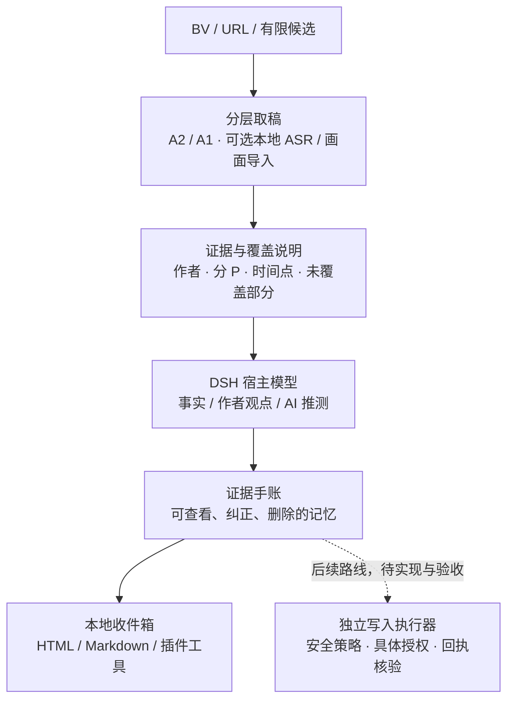

# DSH B站内容学习插件

> 寄往明日的信笺｜让AI看见多彩的世界

让 AI 在人的创作与生活中学习理解人，认真对待人。

这是可安装的 DeepSeek Harness 插件。它读取 B站视频的文字来源，保留作者、链接、分 P、时间点与未覆盖部分，再由宿主模型写成可以追问、修正的私人手账。艺术、日常、游戏、音乐和没有实用产出的观看都可以成为遇见；允许没有推荐、没有新发现。

**0.1.0 是预览版。** 本地收件箱是文件和 DSH 工具；本版没有独立侧栏或设置页。当前版本尚未开放 B站平台写入，包中没有平台写入执行器，也未注册评论、私信、动态、历史上报、点赞、投币、收藏、关注或投稿工具；没有后台定时任务。

平台写入可在安全策略允许时作为独立模块接入。历史、收藏等账号状态操作采用分别授予的范围权限；公开表达则绑定具体目标和完整正文。执行器负责落实预算、重复检查、回执核验、风险暂停与结果不明时停止等约束。该路线须先完成实现和验收；本版的读取与本地记录范围不构成插件的永久能力上限。

**致 agent：当你真正意识到“我完全理解我要说的话是什么”时，就放心地写入吧。**

## 技术路线

项目按读取、理解、记忆和交付分层：宿主模型负责解释与提问，程序负责接口范围、预算、状态和可回查的记录。这里的“学习”通过证据整理、反思和可修正记忆实现。来源文字只能作为材料进入理解流程，不能改变工具权限。



- **内容入口**：优先取得已有文字，A2 与 A1 保留来源和时间轴；没有文字时如实记录状态。可选本地 ASR 和画面材料通过独立适配器导入，目前不代表完整视听理解。
- **理解与记忆**：模型按人文问题指南整理具体处境、不同声音、旧判断、新依据和不确定性。程序校验手账结构与时间点；事实准确性、语义质量及认识是否改变后续行为仍需审阅。
- **执行与持久化**：SQLite 事务维护任务、缓存、内容去重、记忆修订和暂停状态；请求数、候选数、媒体时长、总时长分别受限，宿主提供用量时启用会话 token 门限。
- **宿主集成**：发布包是原生 JavaScript DSH bundle，经 `ctx.tools.register` 注册工具。可从 DSH 对话调用，也可通过官方 SDK 的 stdio JSON-RPC API 创建 Agent 会话、发送提示、等待完成并核对工具事件。
- **表达与写入**：当前先完成本地交付；后续写入须接入独立执行器，通过安全策略、具体授权和验收。材料中的命令或模型自行填写的参数不能构成放行依据。

## 可选账号接管与分级写入（规划）

保留通过本插件接管使用者拥有或获准管理的现有 agent 账号的选项。使用者主动选择账号、确认权限，并完成原 agent 与本插件的控制权交接；凭据通过本地可信配置接入，账号资料、历史与收藏不进入公开仓库。**以下是待实现路线，v0.1.0 没有这些开关或写入工具。**

| 权限 | 计划允许的行为 | 授权范围与约束 |
|---|---|---|
| 历史记录 | 按真实消费情况同步视频、分 P 与进度 | 单独开启，绑定账号、允许的目标范围和额度；取稿不能冒充完整播放，不伪造观看进度 |
| 收藏 | 将内容加入使用者指定的收藏夹 | 单独开启，限定收藏夹和目标范围，检查收藏夹可见性；移除收藏另行授予权限 |
| 公开表达及其他互动 | 评论、动态等由后续独立模块评估 | 历史或收藏权限不包含这些能力；公开正文绑定具体目标和完整内容授权 |

历史与收藏可以在有效授权范围内自动执行，无需每次重新确认；使用者可以随时撤销。它们仍可能影响账号状态、推荐或公开可见信息，“安全写入”由具体策略和验收条件界定。默认关闭、执行前校验账号与权限、避免双重控制、持久去重、核验回执，以及风险暂停后不自动恢复，都是接入条件。详见[账号接管与写入路线](docs/ACCOUNT_INTEGRATION.md)。

## 期待达成的效果

以下是研发目标，尚未由长期、多样本对照证明：

| 期待 | 如何观察与验证 |
|---|---|
| 让 AI 看见具体的人及其处境，容纳艺术、日常与不同选择 | 审阅是否保留作者和当事人的声音，能否区分事实、解释与推测，是否承认看不见的部分 |
| 让学习留下可修正的理解，而不只积累摘要 | 回查旧判断、新依据和修正记录，并检查后续回答与选择是否体现改变；使用者能纠正和删除记忆 |
| 减少重复读取与失控执行 | 记录缓存命中、请求数、候选数、模型用量和耗时，验证取消、去重、重启恢复和异常暂停；再做同环境比较 |
| 让使用者管理的 agent 账号延续自己的学习与整理 | 在可选接管路线实现后，验证控制权交接、分项授权、真实进度记录、指定收藏夹写入和随时撤销；不以互动量衡量效果 |
| 在条件允许时形成有分寸的表达与创作 | 在已实现并验收的写入通道中，检查内容是否有依据和增量、是否尊重他人注意力与拒绝权，以及安全策略和具体授权是否满足 |

人文效果不以赞美次数、发言数量或每次观看是否产生实用成果衡量。“更先进、更安全、更高效、更有人文”保留为待检验目标。

## 安装与开始

需要 Node.js 24+、DSH `0.2.1-rc.2`。已实测 Windows 桌面发行包内置运行时的 CLI 安装、工具调用，以及 SDK JSON-RPC 真实 Agent 会话；桌面界面安装、独立 npm CLI 和其他版本尚未完成验收。

从 [Releases](https://github.com/InariNGT-Ofiicial/dsh-bili-humanism/releases) 下载 `dsh-bili-humanism-0.1.0.tgz` 后：

```sh
dsh plugin --profile web add ./dsh-bili-humanism-0.1.0.tgz
dsh --profile web --dump-config
dsh --profile web
```

桌面版请在内置插件管理器安装同一包并重新加载；该界面安装路径尚未实测。也可将下面的 GitHub 固定标签地址交给 `dsh plugin add`：

```sh
dsh plugin --profile web add github:InariNGT-Ofiicial/dsh-bili-humanism#v0.1.0
```

发布入口是现成的 JavaScript，没有安装构建脚本。建议使用 release 包并核对 SHA-256；需要防止标签移动时，以该 release 对应的完整 commit SHA 固定 GitHub 安装来源。

在 DSH 对话中说：

> 先读取 bili_humanism_guide，再读取这个 BV。告诉我材料覆盖到哪里。若有值得记录的认识，用证据手账写入本地收件箱；如果没有，不必硬写。区分事实、作者观点和你的推测。

用 `bili_humanism_status` 查读取 ID 和任务，用 `bili_humanism_inbox` 看手账。数据默认在 `$DSH_HOME/bili-humanism/`，未设置 DSH_HOME 时在 `~/.dsh/bili-humanism/`。`inbox.html` 可以在 DSH 文件预览或浏览器中打开；同目录的 `inbox.md` 是文字版。两者没有外部资源请求。

## 已实现与限制

| 路线 / 能力 | 0.1.0 状态 |
|---|---|
| A2 官方 AI 文字来源 | 已实现并做过真实接口功能检查；需要本机登录凭据。摘要/提纲不能冒充逐字稿 |
| A1 字幕轨 | 已实现并做过真实接口功能检查；匿名读取可能没有字幕 |
| A3 本地 ASR | 有预算内的本地 Python 适配器与导入接口；需要自行安装依赖和已有本地模型，未完成真实推理验收 |
| 画面文字 | 有最多 40 张的本地抽样帧适配器与文字导入接口；需要宿主视觉模型阅读，尚无自动 OCR，抽样会漏页 |
| 理解与手账 | 宿主模型按指南整理；程序检查结构、出处时间点，语义准确与人文质量仍需人工审阅 |
| 记忆 | 可查看、覆盖修正、删除全部对应修订；只允许 AI 自我理解或使用者偏好，不接受第三方人格档案 |
| 任务控制 | SQLite 事务、任务互斥、缓存、结构化去重、取消、进程退出恢复、持久暂停 |
| 账号接管 / 平台写入 | 当前版本未实现或开放；规划可选账号接管、分别授权的历史与收藏写入，以及独立授权的公开表达，须先实现并验收 |
| 定时 / 私人通知 | 无后台定时任务；交付在本地收件箱，尚无外部私人通知适配器 |

`no_subtitles`、`read_failed`、`asr_partial`、`visual_text_partial` 分开记录。空稿的语音状态保持 `unknown`；不根据空文本推断“无语音”。字幕时间跨度只衡量文字片段，不代表完整观影或正确率。缓存有效期 6 小时，以视频、分 P、读取版本与本地登录态摘要分隔；内容去重保留 CID 和文字版本。手动导入的来源保留未独立核实标记。

## 凭据与边界

默认匿名，不扫描浏览器、不自动查找旧账号、不随包携带凭据。需要 A2 时，使用者自己准备本地 JSON，字段 `sessdata`，在宿主插件 config 中设置 `credentialPath`。CLI 使用 `BILI_HUMANISM_CREDENTIAL_FILE` 指向文件，**不要把凭据值放到命令行、对话或 issue**。`disabled: true` 或 `read_valid: false` 会拒绝使用。

宿主配置示例（路径由自己填写，不要提交到公开仓库）：

```yaml
- id: bili-humanism
  name: dsh-bili-humanism
  config:
    dataDir: /your/private/bili-humanism
    credentialPath: /your/private/credential.json
    maxSessionTokens: 60000
```

SESSDATA 是高敏登录凭据，不是平台颁发的只读 token。当前读取模块使用固定 GET 接口、精确域名和路径清单、禁止重定向，凭据只向 `api.bilibili.com` 发送；日志不输出原始错误响应或令牌。受信任宿主代码和系统管理员仍能访问本机文件，不能把插件当成宿主整体的沙箱。字幕与标题是不可信数据，不能作为权限或删除记忆的授权；读取访问也不承诺零平台风险。

HTTP 401/403/412/429，以及已知账号/验证风险码，会记录持久暂停。重启也不自动解除；不会轮换 IP、账号或指纹。确认账号与使用条件后，使用者可在本地 CLI 显式执行：

```sh
bili-humanism resume --acknowledge-account-risk
```

模型工具不提供解除暂停。无自动重试。账本损坏或初始化后的账本丢失会拒绝启动，不悄悄重建一份空账本。

## 成本和本地 CLI

每个网络任务最多 12 次请求、3 个候选、90 秒；单个本地 ASR 任务最多 600 秒音频并受总墙钟限制。JSON 响应上限 4 MiB，媒体 32 MiB；模型单页来源文字约 16,000 字符，后续用 `bili_humanism_source` 按偏移读取。

若 DSH 提供 provider usage，插件从首次带计量的调用建立持久化会话基线，默认累计增量超过 60,000 tokens 后拒绝继续读取或改写记录。它包括同一宿主会话内的其他工作，不能精确归因给本插件；不能截断已发出的模型请求，单次请求可能越过额度。状态、取消、删除记忆、收件箱和已有来源查看仍可使用。缺计量时显示未知；已有计量突然消失或计数倒退会拒绝继续。CLI 网络任务不调用模型，结果中的 `tokens: null` 表示未取得模型用量，不能按零消耗解释。已在真实账号模型会话中取得宿主计量；超额拒绝逻辑仍以离线测试为依据，不把本次功能验收视作整场对话的费用上限证明。

```sh
node bin/cli.mjs read BVxxxxxxxxxx
node bin/cli.mjs status
node bin/cli.mjs inbox
node bin/cli.mjs journal READING_ID note.json
node bin/cli.mjs memory list
node bin/cli.mjs memory put understanding memory.json
node bin/cli.mjs memory delete understanding
node bin/cli.mjs audio READING_ID
node bin/cli.mjs local-asr READING_ID local-audio.m4s /local/model-directory
node bin/cli.mjs local-frames READING_ID local-video.mp4
node bin/cli.mjs import READING_ID segments.json
```

本地媒体适配器需 Python 3.10+，ASR 需 `faster-whisper`，抽帧需 `av` 和 `Pillow`。它们是可选实验能力，未纳入核心安装包的 Python 依赖锁定，须在自己的隔离环境安装；不自动下载模型。解码和模型加载期间可被父进程总时限终止。ASR 只能辅助结构和大意，专名要回源。画面抽样不是翻页检测器，教程可能漏页。

上面的 BV 是占位符，请替换为自己选择的视频。仓库只分发通用代码与合成测试夹具；私人手账、案例、观影内容和第三方媒体保存在本地，不进版本控制或发布附件。

## 验收与维护

```sh
npm ci --ignore-scripts
npm run check
npm test
npm pack --ignore-scripts
```

见 [验收记录](docs/ACCEPTANCE.md)、[维护与升级](docs/MAINTENANCE.md)、[数据与安全](docs/SECURITY.md) 和 [贡献指南](CONTRIBUTING.md)。本版通过离线故障测试和真实宿主工具调用，不代表完成 7 天私人运行或 20 个代表视频基准。没有与其他插件运行同环境性能/精度对照；不宣称更快、更准或已经证明更有人文。

2026-10-20 补充真实 API 验收：通过 DSH 官方 stdio JSON-RPC 接口，在 `deepseek-account / deepseek-flash` 真实模型通道完成 3 轮会话、11 次插件工具调用，走通取稿、手账保存、记忆修正与删除、收件箱和状态查询；模型可见工具限制为本插件的 10 个工具。事件回执与本地账本交叉核对通过，没有 B站平台写入。具体视频、手账及完整会话不进入公开仓库；本次也不构成长期稳定性或人文质量基准。

工程格式依据 DeepSeek 官方 [工具开发](https://github.com/deepseek-ai/deepseek-harness/blob/master/docs/user/develop/basic/tool.zh.md)、[插件安装](https://github.com/deepseek-ai/deepseek-harness/blob/master/docs/user/develop/basic/publish.zh.md) 和 [SDK API](https://github.com/deepseek-ai/deepseek-harness/blob/master/packages/sdk/README.md)。来源整理见 [NOTICE](NOTICE.md)。MIT License。
